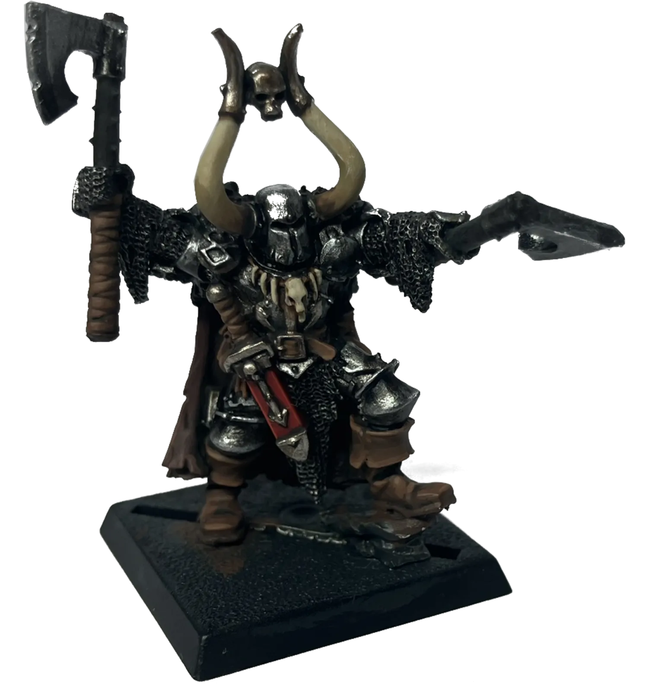

# Chaos

Guerriers corrompus et démons de l'Ancien Monde.

|   |   |   |   |
|---|---|---|---|
| [Chef](#chef) | [Core](#core) | [Spécial](#spécial) | [Rare](#rare) | 

## Chef

---

Un héraut de malheur !

### Champion Exalté

**Statut** : terminé (base à faire)
**Référence** : Games Workshop, Warhammer Old World Nains, 2022
**Jeu** : Warhammer Old World · **Catégorie** : Chef

**Peintures** : 
- Armure : [armure du chaos](/recettes/armures.html#armures-du-chaos)
- Cape : [cuir sale](/recettes/cuirs.html#un-cuir-sale)
- Bottes : [cuir clair](/recettes/cuirs.html#un-cuir-clair)

*1 figurine - Base 30mm *

